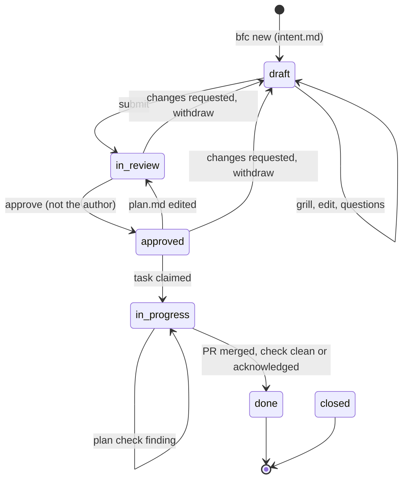
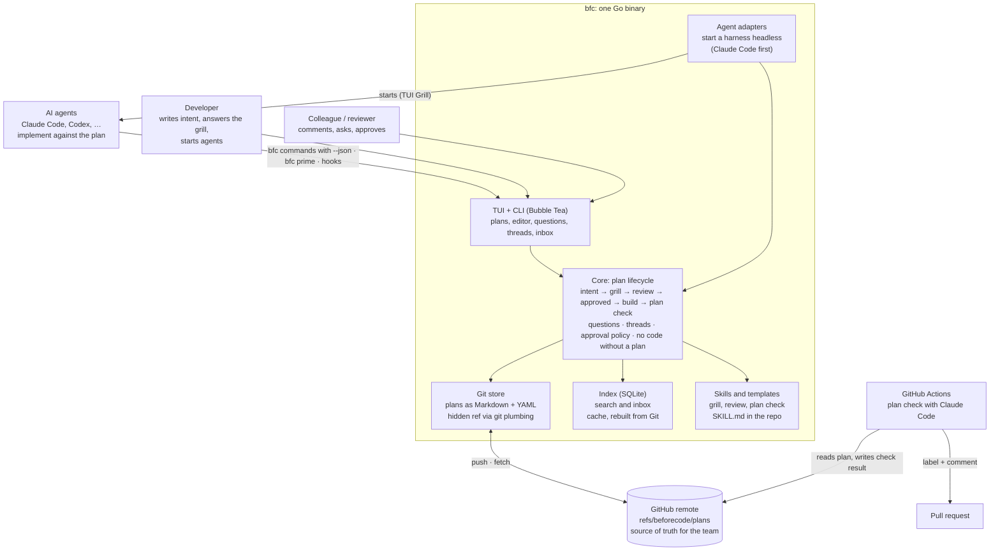

# BeforeCode design

Last updated: 2026-11-19. Decisions marked **confirmed** were made by the maintainer and are not open for redesign.

BeforeCode (`bfc`) is an open source TUI where a team writes, challenges ("grills"), approves and shares plans for AI coding agents. Agents implement only against an approved plan. It packages an AI-native software development lifecycle into one tool that works with nothing but Git.

## 1. Background

### Anthropic: The AI-native SDLC playbook

Source: <https://claude.com/resources/articles/the-ai-native-sdlc-playbook> (21 Aug 2026).

- Development is a loop of six stages (Plan, Design, Build, Test, Deploy, Maintain). Each stage ends by committing an artifact to version control: `intent.md`, `spec.md`, `plan.md`, the diff with tests, the pull request, the incident record.
- "Nothing is implemented without an accepted plan." The approved plan is committed and pull request review checks the diff against it.
- When implementation departs from the plan, the plan is updated in the same change.
- Humans decide at the gates. The agent that wrote the code cannot approve it.
- A skill is an advisory control; a hook is the deterministic one. Rules that must always hold need a hook or a check at pull request time.
- The chain of commits is the audit trail.

### until.dev

Source: <https://until.dev>, <https://github.com/until-dev/plugins>. Closed source apart from an MIT plugin; early access.

- Loop: Brainstorm, Plan, Submit, Run, Check. Rule: "No code until the Plan is agreed."
- A plan check runs on each pull request and reports what is missing, changed, or out of scope. A difference is fixed in code, fixed in the plan, or acknowledged by a person.
- Approval is by another person; the author cannot approve their own plan and an agent cannot replace a human reviewer.
- Enforcement through hooks in several harnesses (Claude Code, Codex, Cursor, OpenCode and others).

BeforeCode shares the idea and differs by being fully open source, Git-only, and by adding grilling and team discussion on the plan.

### Beads

Source: <https://github.com/gastownhall/beads>. An issue tracker for agents that stores its data in the git ref `refs/dolt/data` on the same remote as the code and never commits to code branches. We adopt its ref-based sync pattern and several commands (see section 4) but store plain Markdown instead of a Dolt database.

### Other related tools

Plannotator (plan review UI with annotations fed back to the agent), GitHub Spec Kit and OpenSpec (specs as Markdown in the repo), Task Master (PRD to tasks), Kiro (specs as agent input).

## 2. Confirmed decisions

| Area | Decision |
| --- | --- |
| Language and TUI | Go with Bubble Tea |
| License | Apache-2.0 |
| Command | `bfc` |
| Storage | Hidden git ref `refs/beforecode/plans`, Beads-style, without Dolt |
| Normal branches | Only `.beforecode/config.yaml`, `.beforecode/skills/`, `.beforecode/templates/` and the files written by `bfc setup <harness>` (for Claude Code `.claude/settings.json` and `.claude/skills/beforecode/SKILL.md`), changed through pull requests (ADR 0010) |
| Hosting | GitHub only. The hidden ref is verified on real GitHub (ADR 0001) |
| Scope | One repository. No plans spanning repositories |
| Plan format | Two documents: a short `intent.md` and a `plan.md` for agents with acceptance criteria |
| Approval | Configurable; one approver for now |
| Identity | Git commit author. No signing or further rules yet |
| Plan check | Claude Code in GitHub Actions when a pull request opens. A finding labels the pull request and notifies the plan author in the TUI |
| Agent interface | Agents use the `bfc` CLI with `--json`, like people and scripts; instructions come from the binary (`bfc prime`). No MCP server, no daemon (ADR 0008) |
| Current plan | Bound to the branch by its Short ID (`bfc start`), fallback `bfc use` (ADR 0009) |
| Gates | `submit`, `approve`, `request-changes`, `withdraw` and `close` are for people and refuse to run inside an agent. A Claude Code hook blocks edits unless the Current plan is approved (ADR 0011) |
| AI usage | Everyone uses their own local Claude Code or API key, including for the AI in discussions. The plan check in CI uses one shared key stored in repository secrets |
| Users | Developers with read and write access to the repository. Clients also use the TUI; a web view comes later |
| Notifications | In the TUI (Inbox) only. Email later |
| Sensitive data | Plans are readable by everyone with repository access. Acceptable for internal use |

## 3. Product

### Concepts

See `CONTEXT.md` for the full vocabulary. In short: a **Plan** has an **Intent** and a **Plan document**, moves through states derived from **Events**, collects **Questions** and **Threads**, is challenged in a **Grill**, needs an **Approval**, is split into **Tasks** that agents **Claim**, and its pull request is verified by a **Plan check**.

### Two documents

- `intent.md` is very short, a few sentences to half a page, written by a human: the problem, who it is for, how we know it worked, what we are not solving. It is for first ideas and discussion.
- `plan.md` is for agents. It is produced from the intent after grilling and contains context, approach, affected files and modules, out of scope, tasks, and acceptance criteria.
- Acceptance criteria have stable IDs (`AC-1`, `AC-2`, …) and are written to be verifiable, for example "AC-2: With an invalid card the API returns 402 and the order stays in state awaiting-payment."
- `plan.md` is what gets approved. Changing it after approval requires a new approval.

### Plan lifecycle



A plan can be closed from any state; `closed` is final. The exact file formats and the state derivation rules are in `docs/adr/0002-data-format-v1.md`.

### TUI screens

1. **Inbox**: what waits on me (reviews, questions, plan check findings).
2. **Plan list**: filter by state, author, label; full-text search. `bfc` (or `bfc tui`) opens it. Plans are grouped by state (in-review, approved, draft, then closed and invalid), two lines each: the title, then Short ID, author and last activity. The `s` key cycles the state filter, starting at "open", which hides closed plans; `/` searches title, Short ID and author; `n` asks for a title and runs `bfc new`. The layout was chosen with a prototype; see issue #16.
3. **Plan detail**: Enter on the list opens it. One header line holds the Short ID, the title and the `intent.md` and `plan.md` tabs (Tab switches). The document is rendered with Glamour in a scrollable viewport. A status bar shows state, Approvals, author and the sync status, with the help line below it. `e` edits the shown document through `bfc edit` (not on a closed plan). `s`, `a`, `r` and `c` submit, approve, request changes and close with the CLI's checks, and appear only when the current user may take the action; a refusal is shown as a message. `r` asks for the reason on one line; `c` asks for confirmation on one line, with an optional reason (issue #49). Esc returns to the list. Questions and threads come in phase 3. The layout was chosen with a prototype; see issue #17.
4. **Grill** (issue #66): the author grills the Intent with Claude Code from the plan detail; every Question and answer is saved as a Message. The layout and the state model were chosen with a prototype; see issue #62 and ADR 0012.
   - **Layout**: one Question at a time. Under the header line (Short ID, title, state, the number of the Question) the open Question stands large, or the agent's text while it streams; below it the answered Questions, one line each with the answer under it, newest at the bottom, and Messages from others that sync brought. Then a notice line when there is news (sync, an error), the answer line while an answer is awaited, the status bar (turn state with a spinner, author, sync status) and the help line. It fits 80x24 and cuts lines like every screen.
   - **Turns**: Enter starts or continues the Grill. Each turn runs Claude Code headless through the agent adapter with `--allowedTools "Bash(bfc ask:*)"`; the first turn of a session is prompted with `bfc prime grill <id>`, later ones resume the session with `--resume`. The agent records its Question with `bfc ask`; when the turn ends, the screen waits for an answer to the newest open Question from the AI to the author. A turn that ends without one is an error, and Enter retries it. The answer the author types is stored with the same code as `bfc reply --verbatim` and starts the next turn with the author's words.
   - **States**: idle, agent thinking (its text streams), waiting for the answer, error (with the reason; Enter retries), Grill finished, writing `plan.md`. Esc during a turn stops the claude process: if the agent had already recorded its Question the screen waits for the answer, otherwise it is idle. Esc in any other state returns to the plan detail; the Grill pauses, the session and any open Question stay. Ctrl+C quits `bfc`, stopping a running turn first.
   - **Session**: the Claude session id is kept in `.git/beforecode/grill/<plan ULID>.session`, a disposable local file like the Index. When it is missing or `--resume` fails, the next turn starts a new session from `bfc prime grill <id>`, which holds every Question and answer, so nothing is lost. The file is removed once `plan.md` is written.
   - **Sync** keeps running during a Grill. Messages from others appear below the Question with a notice. When the open Question is answered elsewhere (the CLI, another clone), the answer line closes and Enter continues with the next turn. Messages are append-only, so sync never conflicts with a Grill.
   - **Finishing**: `f` asks the agent for its summary; an open Question stays open and is listed in it. Then `w` writes `plan.md` in one more turn, prompted with `bfc prime plan <id>` and allowed `Bash(bfc edit:*)`, through `bfc edit --stdin`. When `plan.md` is already written, the screen asks the author first; their yes is what allows the agent `--force`. After the save the app returns to the plan detail on `plan.md` and syncs.
5. **Build**: pick a harness, start an agent on a task in a worktree, live output (phase 3).

### Reading plans from the command line

`bfc list` prints one line per plan: Short ID, state, title, author email and last activity, newest activity first. Last activity is the commit time of the newest change to any file of the plan, so an edit of `plan.md` counts. `--state <state>` filters by derived state. Closed plans are left out unless asked for with `--state closed` or `--all`, in the `--json` output too (issue #49).

`bfc list --json` is the stable shape for scripts and agents: an array, newest activity first, of

```json
{
  "id": "01JD3K8Q2W5V7X9Y0Z1A2B3C4D",
  "short_id": "bfc-5v7x",
  "state": "in-review",
  "title": "Payments via Stripe",
  "labels": ["payments"],
  "author": {"name": "Jana Nováková", "email": "jana@example.com"},
  "last_activity": "2026-11-16T21:30:00Z",
  "approvals": 1,
  "required_approvals": 2
}
```

`approvals` counts the valid Approvals of the open review round, and `required_approvals` is 0 outside a round. An invalid plan (no valid `created` event) is listed with state `invalid` and a Short ID computed from its ULID; a plan whose `intent.md` cannot be read has the title `(unreadable intent.md)`.

`bfc search <text>` finds the plans whose title, `intent.md` or `plan.md` contain every word of the text, ignoring case and diacritics, best match first. Front matter and HTML comments (the templates' hints) are not searched. Each plan prints two lines: Short ID, state and title, then an indented snippet with the matches in `[brackets]`. Without a match it prints `no plans match "<text>"` to standard error and exits 0.

All of these read from the index (section 4), which brings itself up to date with the plans ref first.

`bfc doctor` checks the setup, one line per check: `ok`, `warn`, `FAIL` or `skip`. The checks are git version, inside a repository, `config.yaml` valid, local plans ref present, fetch refspec, remote reachable and has the plans ref, every object of the plans ref present, local plans ref not behind or diverged, `format-version` supported, index readable, every event file valid, every plan with a valid `created` event, skipped events, duplicate Short IDs, whether `.beforecode/skills/` exists (a warning when missing, because the skills built into `bfc` stand in), whether `claude.command` is found, whether `.claude/settings.json` runs the `bfc` hook with a `bfc` that is found, and whether the `beforecode` skill is this binary's version of it. A failure prints the command that fixes it, and the exit code is 1 when any check fails; skipped events and duplicate Short IDs are warnings, because concurrent work produces them by design, and a missing Claude Code is a warning, because `bfc` works without it; so is a Claude Code setup without the hook or with a stale skill, which `bfc setup claude` fixes. `bfc doctor --fix` adds the refspec, fetches missing objects again from the remote, pulls when the plans ref is behind or diverged, adds a missing `format-version` in a new commit, and rebuilds an unreadable index; it never pushes and never rewrites the ref. Broken event files and invalid plans are only reported. Details in `docs/adr/0006-doctor.md` and `docs/adr/0007-doctor-repairs-the-plans-ref.md`.

`bfc show <id>` prints a header (Short ID and title, ULID, state, author, approvals, last activity, labels), then the open Questions (one line each: ULID, addressees, `ref` if any, the first line of the text), then `intent.md` and, if present, `plan.md` as plain text. Without an ID it prints the Current plan, and says how to set one (`bfc start`, `bfc use`) when there is none.

`bfc show <id> --json` prints one object for scripts and agents: the fields of `bfc list --json`, then the plan's contents (issue #60):

```json
{
  "id": "01JD3K8Q2W5V7X9Y0Z1A2B3C4D",
  "short_id": "bfc-5v7x",
  "state": "in-review",
  "title": "Payments via Stripe",
  "labels": ["payments"],
  "author": {"name": "Jana Nováková", "email": "jana@example.com"},
  "last_activity": "2026-11-16T21:30:00Z",
  "approvals": 1,
  "required_approvals": 2,
  "approvers": ["peter@example.com"],
  "intent": "---\ntitle: Payments via Stripe\n...",
  "plan": "## Context\n...",
  "acceptance_criteria": ["AC-1", "AC-2"],
  "open_questions": [{"id": "01JD3K8Q2W5V7X9Y0Z1A2B3C4E", "plan": "01JD3K8Q2W5V7X9Y0Z1A2B3C4D", "short_id": "bfc-5v7x", "author": {"name": "Peter Horváth", "email": "peter@example.com"}, "at": "2026-11-16T21:42:00Z", "to": ["jana@example.com"], "ref": "plan.md#AC-2", "body": "Does it retry?"}]
}
```

`intent` and `plan` are the documents as stored, front matter included; `plan` is `null` while there is no `plan.md`. `acceptance_criteria` lists the IDs of the well-formed criteria in the order of `plan.md`. `open_questions` are Messages in the shape of `bfc ask --json`. The lists are `[]` when empty, never `null`.

### Editing plans

`bfc edit <id>` opens `plan.md` (from the template when missing), `--intent` opens `intent.md`. The file is edited in a temporary file outside the repository, in the editor git itself would use (`git var GIT_EDITOR`: `GIT_EDITOR`, `core.editor`, `VISUAL`, `EDITOR`, then `vi`), started through a POSIX shell like git does so that `code --wait` and quoted paths work; on Windows that shell is the `sh.exe` of Git for Windows. An unchanged file makes no commit; an emptied one, or an `intent.md` without a title, is refused and the text kept. If the document changed in the plans ref while the editor was open, nothing is committed and the user's text stays in the temporary file, whose path is printed. `bfc edit <id> --stdin [--intent]` (issue #65) reads the document from stdin instead, for agents, with the same rules; no file is kept, because the caller still has its text. It replaces a `plan.md` only while that is missing or still the template (compared without line endings and surrounding blank space); a written `plan.md` needs `--force`, which applies only to `plan.md`. `--stdin --check` prints the problems of the document and commits nothing, so an agent stores `plan.md` once, after its warnings are fixed, and needs `--force` only to replace a `plan.md` that someone already wrote.

Editing `plan.md` writes no event. Approvals name the `plan_blob` they approve (ADR 0002 section 4), so after an edit they are stale and an approved plan is `in-review` again; `bfc edit` says so. Problems in `plan.md` (ADR 0002 section 6) are printed as warnings; `bfc submit` treats the same checks as errors. `bfc submit` fixes the Approval policy from `config.yaml` in the `submitted` event; `bfc request-changes -m` stores the reason as a Message. `bfc withdraw` lets the plan author end the review round; its Approvals no longer count. `bfc close` closes a plan for good: anyone may close a plan in any lifecycle state, `-m` stores an optional reason as a Message, and every other command then refuses the plan. An invalid plan cannot be closed: without a valid `created` event it would stay invalid, so `bfc doctor` reports it instead.

### Agents and the Current plan

Agents use the same `bfc` commands as people, with `--json` where they read (ADR 0008). The flow in phase 2:

1. `bfc start <id>` creates or switches to the branch `<Short ID>-<slug>`, for example `bfc-a1b2-payments-via-stripe`; the Short ID in the branch name makes the plan the **Current plan** (ADR 0009). The slug is the title in lower-case ASCII letters and digits, diacritics removed, words joined by `-`, at most 48 characters. Everyone who works on a plan works on one branch: `bfc start` first fetches the branches of the sync remote, then takes the local branch that carries the Short ID (such as `feat/bfc-a1b2`), else the plan's branch of the remote, which it checks out tracking it, else it creates a new one and says how to push it. It says when the local branch is behind its upstream. It never pushes; without the network it warns and uses what the clone knows. Several matching branches are listed and none is chosen. `bfc use <id>` sets the Current plan without a branch, in `beforecode/current` of the worktree's own git directory (`.git/beforecode/current` in a plain clone); `bfc use --clear` removes it. The first Short ID in the branch name counts and is resolved like any plan ID, so a longer prefix settles an ambiguous one.
2. The user does not run the CLI; the agent does, and people use the TUI, where the Gates are. Claude Code gets its instructions from **Prime**: the `beforecode` skill, which Claude Code loads whenever the user talks about plans, intents, grilling, what to work on or what waits on them, only tells it to run `bfc prime` and follow it. There is no `SessionStart` hook, so unrelated sessions do not get the plan in their context (ADR 0008).

   `bfc prime [id]` prints Markdown for the agent, at most 8 kB (issue #60): the instructions (the commands an agent may use, that the user works in the TUI, that Gates are for people, that edits need an approved plan, how to record a deviation with `bfc ask --ref plan.md#AC-n`); **Waiting on you** for the git author of the clone (plans in review they may approve now, with "open `bfc` and press `a`", and open Questions addressed to them); then the Current plan or the given one, with its state, Approvals, open Questions and `plan.md` (or `intent.md` while there is none) in a fenced block. Each list stops after ten items with a note on where to see the rest, and a `plan.md` that does not fit is cut at a line with a note to run `bfc show <id>`. A plan with an open Question is not listed for review, because it cannot be approved. Without a plan it lists the approved plans and says how to start one. `bfc prime` reads only the local plans ref and always exits 0: a missing plans ref, an unknown ID or a branch that names a missing plan is printed as a note. `bfc prime <topic> [id]` prints the instructions for one task; with two arguments an unknown topic is an error that lists the known ones. `bfc prime grill [id]` (issue #64) prints the `grill-intent` skill (the repository's copy in `.beforecode/skills/`, else the one built into `bfc`, without its front matter), then the plan with its author and the two commands that record a Grill round, its `intent.md`, and every Question so far with its replies, marked open or answered, so a Grill can continue in a new session. Without an ID it uses the Current plan; like `bfc prime` it never fails over plans. `bfc prime plan [id]` (issue #65) prints the `write-plan` skill the same way, then the plan with the command that stores `plan.md` (`bfc edit <id> --stdin`), the `plan.md` template (the repository's copy wins), `intent.md`, the Grill's Questions and answers, and `plan.md` itself when it is already written.
3. The `PreToolUse` hook (`bfc hook pre-tool-use`) blocks `Edit`, `Write`, `MultiEdit` and `NotebookEdit` unless the Current plan is `approved`, and its block message tells the agent to run `bfc prime`. Files under `.beforecode/` and `.claude/` and files outside the repository are exempt; Bash is not blocked. `claude.enforce: false` turns it off. It remembers an approved Current plan in `.git/beforecode/hook-approved`, so an edit while nothing changed costs one git start (ADR 0011).
4. The **Gates** (`submit`, `approve`, `request-changes`, `withdraw`, `close`) refuse to run inside an agent, detected through `CLAUDECODE`, and `bfc setup claude` denies them in `.claude/settings.json`. This guards against mistakes, not against an agent that unsets the variable (ADR 0011).
5. `bfc setup claude` writes the `PreToolUse` hook and the permissions into `.claude/settings.json` and the `beforecode` skill into `.claude/skills/beforecode/SKILL.md`, which are committed through a pull request (ADR 0010). The skill's text ships in the binary (`internal/agent/claude/SKILL.md`) and is rewritten on every run, so it matches the installed `bfc` (issue #63). The settings are merged: other keys, hooks and permissions keep their place, a `PreToolUse` entry that already runs `bfc hook pre-tool-use` (also through a path to `bfc`) is the hook, and gets the full matcher when it leaves out an edit tool, and invalid JSON is refused before anything is written. There are no slash commands.

**The Grill is stored as Messages** (ADR 0002 section 7), with no format change. A Question by the AI has `agent` set and `to` the plan author. The human's answer, which the agent records word for word, has no `agent` and is a direct reply from the plan author, so it answers the Question. `bfc ask` and `bfc reply` write them.

`bfc ask <id> --to <email|ai>... [--ref <ref>] -m <text>` writes a Question; `bfc reply <message-ULID> -m <text>` writes a reply in the plan that holds that Message, found by its ULID alone. Without `-m` the text is read from stdin; a terminal on stdin is refused rather than waited on. Both print the ULID of the new Message, one new file in one commit (issue #58). `--ref` must have one of the forms of ADR 0002 section 7; whether the heading or criterion exists is not checked, so a stale ref is kept. `--to` takes bare email addresses (no display name) and the word `ai` in any case, repeated or separated by commas; anything else is refused, because no reply could ever answer it. Inside an agent (`CLAUDECODE` set) the Message gets `agent: claude-code`; `bfc reply --verbatim` leaves it out for an answer the agent records word for word for the person running it. A closed plan takes no new Messages. `bfc approve` refuses while the plan has an open Question and lists them. Messages are read straight from the plans ref, not from the index. With `--json` both print the Message:

```json
{
  "id": "01JD3K8Q2W5V7X9Y0Z1A2B3C4E",
  "plan": "01JD3K8Q2W5V7X9Y0Z1A2B3C4D",
  "short_id": "bfc-5v7x",
  "author": {"name": "Peter Horváth", "email": "peter@example.com"},
  "at": "2026-11-16T21:42:00Z",
  "agent": "claude-code",
  "to": ["jana@example.com"],
  "reply_to": "01JD3K8Q2W5V7X9Y0Z1A2B3C4C",
  "ref": "plan.md#AC-2",
  "body": "Does \"exactly one\" also apply when the customer retries the payment?"
}
```

`agent`, `to`, `reply_to` and `ref` are left out when empty.

**Skills ship in the binary** like the templates. `bfc init` writes them to `.beforecode/skills/`, and a Skill file in the repository wins over the built-in one.

### Plan check in GitHub Actions

1. The pull request description carries the plan ID, for example `Plan: bfc-a1b2`. `bfc` or the agent adds it when opening the pull request.
2. Opening the pull request and every later push run a workflow that fetches the plans ref and reads `plan.md`.
3. Claude Code, following the `plan-check` skill, compares the diff with the plan and reports each acceptance criterion as met, not met, or cannot verify. Out-of-scope changes are listed separately.
4. On a finding the workflow adds the label `plan-mismatch` and a summary comment to the pull request, and writes the result into the plans ref as `checks/<ulid>.md`.
5. After the next sync the plan author sees the finding in the Inbox. They fix the code, update the plan, or acknowledge the difference.
6. With no findings the workflow removes the label. The check warns; it does not block the pull request yet.

## 4. Storage: Git is the database

The source of truth is plain text files in Git. SQLite is only a local index for search and the Inbox; it can be deleted and rebuilt from Git at any time.

The index is `.git/beforecode/index.db`. It records the plans ref commit it was built from; when the ref has moved it reads again only the plans whose directory changed. A missing, corrupt or outdated database is rebuilt without a message. Details in `docs/adr/0005-index-cache.md`.

### Layout

```
# On normal branches (changed through pull requests)
.beforecode/
  config.yaml                 # approval policy, sync (ADR 0003); claude.command, claude.enforce in version 3 (ADR 0003)
  skills/                     # defaults embedded in bfc; the repository's copy wins
    grill-intent/SKILL.md       # phase 2
    grill-architecture/SKILL.md
    plan-review/SKILL.md
    plan-check/SKILL.md         # phase 3
  templates/
    intent.md
    plan.md
.claude/                      # written by bfc setup claude (ADR 0010)
  settings.json               # PreToolUse hook, permissions
  skills/beforecode/SKILL.md  # points the agent to bfc prime

# In the hidden ref refs/beforecode/plans (managed only by bfc)
format-version
plans/
  01JD3K8Q2W5V7X9Y0Z1A2B3C4D/   # plan ULID; short ID for people: bfc-5v7x
    intent.md
    plan.md
    events/01JD3M….yaml         # created, submitted, withdrawn, approved, changes-requested, closed
    messages/01JD3N….md         # one message per file; questions, answers and threads
    handoff/01JD3Q….md          # agent notes after a task (phase 3)
    checks/01JD3R….md           # plan check result from GitHub Actions (phase 3)
```

### Why this shape

- **No merge conflicts in discussion.** Every message, question and event is a new file named by ULID. Two people writing at once produce two new files and Git merges them.
- **State is derived, not stored.** Plan state is computed from `events/` (append-only), so concurrent edits cannot corrupt it and the approval history is auditable.
- **Conflicts can only happen in `intent.md` and `plan.md`.** Those are resolved with a normal three-way merge, shown in the TUI as a diff.
- **Agents need no integration.** `bfc prime`, `bfc show --json` and `bfc export` hand a plan to any harness that can run a shell command.

### How the hidden ref works

See `docs/adr/0001-plans-in-a-hidden-git-ref.md` for what was verified and the consequences.

- **Write** without touching the working tree: `git hash-object -w`, a temporary index via `GIT_INDEX_FILE`, `git write-tree`, `git commit-tree`, `git update-ref refs/beforecode/plans <new> <old>` (the old value makes a concurrent local writer fail instead of losing a commit).
- **Minimum git: 2.38**, because of `git merge-tree --write-tree`; every other plumbing command is much older. `store.Open` refuses an older git with an error that names the minimum. Sources in `docs/research/minimum-git-version.md`.
- **Share**: `git push origin refs/beforecode/plans`. Fetch with the refspec `+refs/beforecode/*:refs/beforecode-remote/*`, which `bfc init` and `bfc bootstrap` write to `.git/config`.
- **Concurrent writes**: a rejected push (GitHub reports `fetch first`) triggers fetch, an in-memory merge with `git merge-tree --write-tree`, a merge commit, and a retry, at most 5 attempts. Never force-push. A real conflict in `intent.md` or `plan.md` commits nothing and lists both versions; `bfc pull --keep local|remote` resolves it file by file. Details in `docs/adr/0004-sync-merge-and-retry.md`.
- **Sync cadence**: every change is a commit to the ref. While the TUI is open it syncs in the background every `sync.interval` seconds (default 15) and after every local change; one sync runs at a time, and offline or conflict never block local work. The status is synced, syncing, offline (with git's message) or conflict (with the `bfc pull --keep` hint). The state model was settled with a prototype; see issue #17. `bfc push`, `bfc pull` and `bfc sync` (pull, then push) exist for scripts and agents. All of them use `sync.remote` from the config, or `origin` without a config file.

### What we take from Beads

| Beads pattern | BeforeCode |
| --- | --- |
| Data in a ref, only small config on branches | Plans in `refs/beforecode/plans`; `config.yaml`, `skills/`, `templates/` and the harness files of `bfc setup` on branches so rule changes go through pull requests |
| `bd bootstrap` finds the ref after a clone and fetches the data | `bfc bootstrap` does the same and sets the refspec; it refuses a `format-version` newer than the binary, and in a clone already set up it pulls. `bfc init` creates the ref in a new project. Any other command in a clone without the local ref asks the sync remote (`git ls-remote`, only then, at most 10 seconds) and suggests `bfc bootstrap` or `bfc init`; without an answer it suggests both |
| Every write is a commit; push and pull are explicit commands | Same, plus automatic sync in the TUI |
| Hash IDs (`bd-a1b2`) that grow in length and never collide across machines | Internal ID is a ULID; the short ID `bfc-a1b2` is derived from it. No counter |
| `bd ready`, `bd update --claim` | `bfc ready` lists tasks from approved plans; `bfc claim` writes an event and pushes at once. The first claim to reach the remote wins |
| `bd setup claude`, `bd prime`, instructions in `AGENTS.md` | `bfc setup claude` (later other harnesses); `bfc prime` prints the rules and the Current plan, from the binary, so they match the installed version |
| Push at session end before it is safe to stop | A Stop hook in Claude Code checks that the handoff is written and the ref is pushed (phase 3) |
| `issues.jsonl` export for viewers | `bfc export` renders a plan to Markdown or HTML |
| `bd init --stealth`, `--contributor` | `bfc init --local` for solo use without sharing; configurable `sync.remote` |
| `bd doctor --fix`, schema version guard | `bfc doctor` checks git, the config, the plans ref, refspec, remote, `format-version`, the index and every event file; `--fix` adds the refspec, fetches missing objects, pulls, adds a missing `format-version` and rebuilds the index (ADR 0006, 0007). `format-version` lives in the ref; an older binary refuses to write a newer format |

## 5. Technology stack

| Area | Choice | Why |
| --- | --- | --- |
| Language | Go | One static binary for macOS, Linux and Windows; simple distribution; low barrier for contributors |
| TUI | Bubble Tea, Bubbles, Lip Gloss | Elm architecture, testable, ready-made components |
| Markdown in the TUI | Glamour | Render the plan in the terminal |
| Forms | Huh | Interactive wizards when they come; `bfc init` takes flags only (issue #8, ADR 0003) |
| Plan editing | `$EDITOR` | Developers write in their own editor; the TUI textarea is for short messages |
| Git | System `git` through a subprocess | Respects SSH keys, credential helpers, commit signing and user hooks |
| Data format | Markdown + YAML front matter, ULID IDs | Readable by people and agents; ULIDs sort by time |
| Index | SQLite (`modernc.org/sqlite`, no CGO) with FTS5 | Full-text search and Inbox without a C toolchain |
| Agents | Claude Code headless (`claude -p --output-format stream-json`) as a subprocess | Uses the user's own subscription and settings; the same pattern fits other harnesses |
| Agent interface | The `bfc` CLI with `--json`; `bfc prime` for instructions | One interface for people, scripts and agents; any harness with a shell can use it. No MCP server and no daemon (ADR 0008) |
| Claude Code integration | The `beforecode` skill, a hook and permissions written by `bfc setup claude` into `.claude/` | The skill loads when the user talks about plans and points to `bfc prime`; a `PreToolUse` hook blocks code edits without an approved plan (ADR 0008, 0011) |
| Tests | `teatest` for the TUI, golden files, integration tests on temporary git repositories | Two "team members" can be simulated without a network |
| Release | GoReleaser, Homebrew tap, `go install` | Binaries for all platforms |

## 6. Architecture

`bfc` is one binary with three layers: interfaces (TUI, the CLI that people, scripts and agents use, and agent adapters that start a harness), a core that owns the plan lifecycle rules, and adapters for Git, the index and skills. The core does not know which harness is running.



Everything inside the `bfc` box runs locally for each team member; team members meet only through the GitHub remote. A sync server and a web view can be added later without changing the core.

### Main flows

1. **New plan**: the developer creates a plan in the TUI; the core writes `intent.md` and a `created` event to the plans ref and syncs.
2. **Grill**: in the TUI the core loads a Skill and starts Claude Code headless through the agent adapter; in Claude Code the developer asks for a grill and the agent follows `bfc prime grill <id>`. Either way each Question and answer is stored as a Message with `bfc ask` and `bfc reply`. The agent then writes `plan.md` through `bfc edit --stdin`, following `bfc prime plan <id>`.
3. **Review**: after sync a colleague sees the plan, comments, asks questions, and approves. The approval is an event carrying their name. Gates are taken by people only.
4. **Build**: the developer runs `bfc start <id>` and Claude Code in that branch. The agent runs `bfc prime` when the user talks about the plan and reads it with `bfc show --json`, and a hook blocks edits unless the Current plan is approved. In phase 3 the Build screen starts agents on claimed tasks in worktrees, and agents write handoffs with a `bfc` command.
5. **Check**: GitHub Actions compares the pull request with the plan and reports findings to the pull request and the plan author's Inbox.

### Agent adapter interface

Every harness implements the same small interface, so a new harness is a new package, not a change to the core.

```go
type Agent interface {
    Name() string
    Capabilities() Caps                                    // hooks, resume, headless
    Run(ctx context.Context, t Task) (<-chan Event, error) // stream of messages, questions and the result
}
```

Here `Task` and `Event` are the adapter's own types, not the Tasks of `plan.md` or the Events of the Plans ref: an `agent.Task` is one turn of the harness (the prompt, an optional harness session to resume, the allowed tools and the working directory), and an `agent.Event` is one item of its output: text, a tool use, the result (which carries the session id for the next turn) or an error. A failed or cancelled run ends with an error, never a panic or a hang. The Claude Code adapter (`internal/agent/claude`, #59) runs `<claude.command> -p --output-format stream-json --verbose [--resume <session>] [--allowedTools …] -- <prompt>` and reads the `assistant` and `result` lines; its tests replay output recorded from a real Claude Code 2.1.328 through a fake binary.

### Package layout

```
templates.go      default templates embedded from .beforecode/templates (ADR 0003)
cmd/bfc/          entry point
internal/config/  .beforecode/config.yaml parsing and validation (ADR 0003, no I/O)
internal/core/    plan lifecycle, events, approval policy (no I/O)
internal/store/   hidden-ref storage through git plumbing
internal/index/   SQLite cache rebuilt from the ref
internal/doctor/  bfc doctor: setup checks and safe fixes (ADR 0006, 0007)
internal/agent/   Agent interface and harness adapters
internal/tui/     Bubble Tea screens
e2e/              end-to-end test: the bfc binary in two clones of one bare remote
```

## 7. Implementation phases

Each phase ends in a usable version with a clear exit criterion. Phases 0 and 1 are broken into GitHub issues; later phases are one tracking issue each until they come up. From phase 2 on, plan BeforeCode in BeforeCode.

| Phase | Content | Done when |
| --- | --- | --- |
| **0. Foundations and GitHub verification** | Go module, package layout, CI, license, contribution docs, skills in the repo. Spike: hidden ref on real GitHub (push, fetch, concurrent write, read and write from Actions). ADR for data format v1 | CI is green and the spike confirms the hidden ref works on GitHub |
| **1. Plans in the hidden ref, no AI (MVP)** | `bfc init`, `bootstrap`, `new`, `list`, `show`, `edit`, `submit`, `approve`, `push`, `pull`, `doctor`. `intent.md` and `plan.md`, state from events, short IDs, SQLite index, TUI list and detail | Two people on two machines create, edit and approve a plan through GitHub without conflicts |
| **2. Claude Code integration** | Decisions in ADR 0008 to 0012. The Current plan (`bfc start`, `bfc use`), Gates for people, `bfc ask` and `bfc reply`, the agent adapter for Claude Code headless, `bfc prime` and `bfc show --json`, `bfc hook pre-tool-use`, `bfc setup claude`, the `beforecode` skill, skills in the binary with `bfc prime grill`, `bfc edit --stdin` with `bfc prime plan`, the TUI Grill screen | A developer goes from an Intent through a Grill in the TUI to an approved plan, and Claude Code set up with `bfc setup claude` implements it while the hook blocks edits without an approved plan |
| **3. Team collaboration and plan check** | Questions with addressees, threads on sections, AI in Threads, Inbox, configurable approval. Tasks, `bfc ready`, `bfc claim`, handoffs, `bfc ask --wait`. The Build screen and worktrees. GitHub Actions workflow with Claude Code for the plan check | A pull request outside the plan gets the label and the plan author sees the finding in the Inbox |
| **4. Harness independence** | Adapters for Codex, OpenCode, Gemini CLI and a generic adapter over ACP. Export of rules to `AGENTS.md` | The same plan is implemented by at least one other harness without changing the plan |
| **5. Notifications and learning from the loop** | Email notifications. Archive of finished plans, metrics, proposed skill changes from recurring findings | A reviewer gets an email and a plan retro proposes a skill change |
| **6. Web and server (later)** | Web view for clients, realtime chat, stricter identity, GitLab, multiple repositories | A client without the TUI answers a question on a plan |

## 8. Open points

- **Forks.** Whether a GitHub fork carries the plans ref is not verified, and on pull requests from forks `GITHUB_TOKEN` is read-only, so the plan check cannot write its result or label the pull request. Not needed while all users have write access; revisit before accepting outside contributions through `bfc`. See ADR 0001 and #29.
- **Exact `plan.md` template.** The v1 template is in `.beforecode/templates/` (ADR 0002); refined on the first real plan.
- **Splitting a plan into tasks.** A task list in `plan.md` for now; detail in phase 3.
- **MCP.** Dropped as the agent interface (ADR 0008). Revisit in phase 4 only if a harness cannot run shell commands.
- **How Beads makes a claim atomic across machines** is not documented; our rule is "first claim to reach the remote wins".
