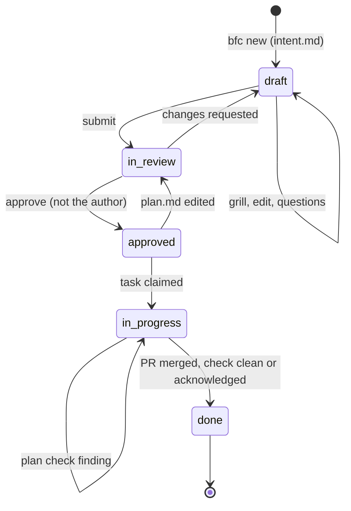
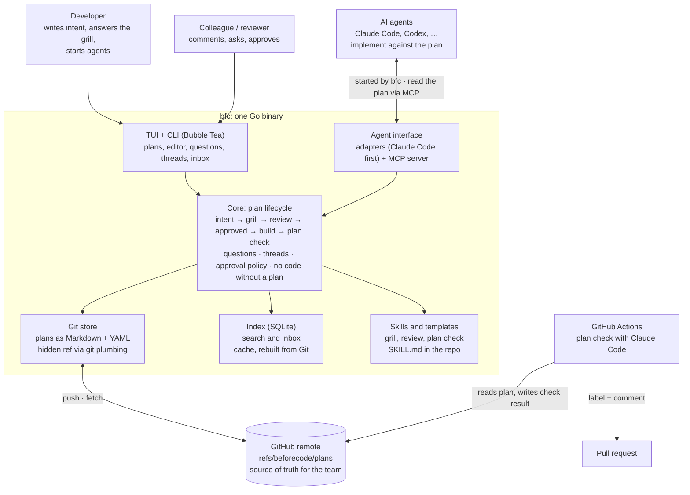

# BeforeCode design

Last updated: 2026-11-16. Decisions marked **confirmed** were made by the maintainer and are not open for redesign.

BeforeCode (`bfc`) is an open source TUI where a team writes, challenges ("grills"), approves and shares plans for AI coding agents. Agents implement only against an approved plan. It packages an AI-native software development lifecycle into one tool that works with nothing but Git.

## 1. Background

### Anthropic: The AI-native SDLC playbook

Source: <https://claude.com/resources/articles/the-ai-native-sdlc-playbook> (21 Aug 2026).

- Development is a loop of six stages (Plan, Design, Build, Test, Deploy, Maintain). Each stage ends by committing an artifact to version control: `intent.md`, `spec.md`, `plan.md`, the diff with tests, the pull request, the incident record.
- "Nothing is implemented without an accepted plan." The approved plan is committed and pull request review checks the diff against it.
- When implementation departs from the plan, the plan is updated in the same change.
- Humans decide at the gates. The agent that wrote the code cannot approve it.
- A skill is an advisory control; a hook is the deterministic one. Rules that must always hold need a hook or a check at pull request time.
- The chain of commits is the audit trail.

### until.dev

Source: <https://until.dev>, <https://github.com/until-dev/plugins>. Closed source apart from an MIT plugin; early access.

- Loop: Brainstorm, Plan, Submit, Run, Check. Rule: "No code until the Plan is agreed."
- A plan check runs on each pull request and reports what is missing, changed, or out of scope. A difference is fixed in code, fixed in the plan, or acknowledged by a person.
- Approval is by another person; the author cannot approve their own plan and an agent cannot replace a human reviewer.
- Enforcement through hooks in several harnesses (Claude Code, Codex, Cursor, OpenCode and others).

BeforeCode shares the idea and differs by being fully open source, Git-only, and by adding grilling and team discussion on the plan.

### Beads

Source: <https://github.com/gastownhall/beads>. An issue tracker for agents that stores its data in the git ref `refs/dolt/data` on the same remote as the code and never commits to code branches. We adopt its ref-based sync pattern and several commands (see section 4) but store plain Markdown instead of a Dolt database.

### Other related tools

Plannotator (plan review UI with annotations fed back to the agent), GitHub Spec Kit and OpenSpec (specs as Markdown in the repo), Task Master (PRD to tasks), Kiro (specs as agent input).

## 2. Confirmed decisions

| Area | Decision |
| --- | --- |
| Language and TUI | Go with Bubble Tea |
| License | Apache-2.0 |
| Command | `bfc` |
| Storage | Hidden git ref `refs/beforecode/plans`, Beads-style, without Dolt |
| Hosting | GitHub only. The hidden ref is verified on real GitHub (ADR 0001) |
| Scope | One repository. No plans spanning repositories |
| Plan format | Two documents: a short `intent.md` and a `plan.md` for agents with acceptance criteria |
| Approval | Configurable; one approver for now |
| Identity | Git commit author. No signing or further rules yet |
| Plan check | Claude Code in GitHub Actions when a pull request opens. A finding labels the pull request and notifies the plan author in the TUI |
| AI usage | Everyone uses their own local Claude Code or API key, including for the AI in discussions. The plan check in CI uses one shared key stored in repository secrets |
| Users | Developers with read and write access to the repository. Clients also use the TUI; a web view comes later |
| Notifications | In the TUI (Inbox) only. Email later |
| Sensitive data | Plans are readable by everyone with repository access. Acceptable for internal use |

## 3. Product

### Concepts

See `CONTEXT.md` for the full vocabulary. In short: a **Plan** has an **Intent** and a **Plan document**, moves through states derived from **Events**, collects **Questions** and **Threads**, is challenged in a **Grill**, needs an **Approval**, is split into **Tasks** that agents **Claim**, and its pull request is verified by a **Plan check**.

### Two documents

- `intent.md` is very short, a few sentences to half a page, written by a human: the problem, who it is for, how we know it worked, what we are not solving. It is for first ideas and discussion.
- `plan.md` is for agents. It is produced from the intent after grilling and contains context, approach, affected files and modules, out of scope, tasks, and acceptance criteria.
- Acceptance criteria have stable IDs (`AC-1`, `AC-2`, …) and are written to be verifiable, for example "AC-2: With an invalid card the API returns 402 and the order stays in state awaiting-payment."
- `plan.md` is what gets approved. Changing it after approval requires a new approval.

### Plan lifecycle



### TUI screens

1. **Inbox**: what waits on me (reviews, questions, plan check findings).
2. **Plan list**: filter by state, author, label; full-text search.
3. **Plan detail**: rendered Markdown on the left, questions and threads on the right, editing through `$EDITOR`.
4. **Grill**: chat with the AI over the plan; every answer is saved.
5. **Build**: pick a harness, start an agent on a task, live output.

### Plan check in GitHub Actions

1. The pull request description carries the plan ID, for example `Plan: bfc-a1b2`. `bfc` or the agent adds it when opening the pull request.
2. Opening the pull request and every later push run a workflow that fetches the plans ref and reads `plan.md`.
3. Claude Code, following the `plan-check` skill, compares the diff with the plan and reports each acceptance criterion as met, not met, or cannot verify. Out-of-scope changes are listed separately.
4. On a finding the workflow adds the label `plan-mismatch` and a summary comment to the pull request, and writes the result into the plans ref as `checks/<ulid>.md`.
5. After the next sync the plan author sees the finding in the Inbox. They fix the code, update the plan, or acknowledge the difference.
6. With no findings the workflow removes the label. The check warns; it does not block the pull request yet.

## 4. Storage: Git is the database

The source of truth is plain text files in Git. SQLite is only a local index for search and the Inbox; it can be deleted and rebuilt from Git at any time.

### Layout

```
# On normal branches (changed through pull requests)
.beforecode/
  config.yaml                 # approval policy, harnesses, sync.remote
  skills/
    grill-intent/SKILL.md
    grill-architecture/SKILL.md
    plan-review/SKILL.md
    plan-check/SKILL.md
  templates/
    intent.md
    plan.md

# In the hidden ref refs/beforecode/plans (managed only by bfc)
format-version
plans/
  01JD3K-payments-via-stripe/   # short ID for people: bfc-a1b2
    intent.md
    plan.md
    events/01JD3M….yaml         # created, submitted, approved, changes-requested, claimed, checked, done
    questions/01JD3N….md        # one question per file, answer in the same file
    threads/01JD3P….md          # one message per file (author, time, section reference)
    handoff/01JD3Q….md          # agent notes after a task
    checks/01JD3R….md           # plan check result from GitHub Actions
```

### Why this shape

- **No merge conflicts in discussion.** Every message, question and event is a new file named by ULID. Two people writing at once produce two new files and Git merges them.
- **State is derived, not stored.** Plan state is computed from `events/` (append-only), so concurrent edits cannot corrupt it and the approval history is auditable.
- **Conflicts can only happen in `intent.md` and `plan.md`.** Those are resolved with a normal three-way merge, shown in the TUI as a diff.
- **Agents read ordinary files.** `bfc prime` and `bfc export` hand a plan to any harness, even one with no integration.

### How the hidden ref works

See `docs/adr/0001-plans-in-a-hidden-git-ref.md` for what was verified and the consequences.

- **Write** without touching the working tree: `git hash-object -w`, a temporary index via `GIT_INDEX_FILE`, `git write-tree`, `git commit-tree`, `git update-ref refs/beforecode/plans`.
- **Share**: `git push origin refs/beforecode/plans`. Fetch with the refspec `+refs/beforecode/*:refs/beforecode-remote/*`, which `bfc init` and `bfc bootstrap` write to `.git/config`.
- **Concurrent writes**: a rejected push (GitHub reports `fetch first`) triggers fetch, an in-memory merge with `git merge-tree --write-tree`, a merge commit, and a retry. Never force-push.
- **Sync cadence**: every change is a commit to the ref. The TUI fetches and pushes automatically while a plan is open (every 10 to 30 seconds). `bfc push` and `bfc pull` exist for scripts and agents.

### What we take from Beads

| Beads pattern | BeforeCode |
| --- | --- |
| Data in a ref, only small config on branches | Plans in `refs/beforecode/plans`; `config.yaml` and `skills/` on branches so rule changes go through pull requests |
| `bd bootstrap` finds the ref after a clone and fetches the data | `bfc bootstrap` does the same and sets the refspec. `bfc init` creates the ref in a new project |
| Every write is a commit; push and pull are explicit commands | Same, plus automatic sync in the TUI |
| Hash IDs (`bd-a1b2`) that grow in length and never collide across machines | Internal ID is a ULID; the short ID `bfc-a1b2` is derived from it. No counter |
| `bd ready`, `bd update --claim` | `bfc ready` lists tasks from approved plans; `bfc claim` writes an event and pushes at once. The first claim to reach the remote wins |
| `bd setup claude`, `bd prime`, instructions in `AGENTS.md` | `bfc setup claude` (later other harnesses); `bfc prime` prints the current plan, task and rules |
| Push at session end before it is safe to stop | A Stop hook in Claude Code checks that the handoff is written and the ref is pushed |
| `issues.jsonl` export for viewers | `bfc export` renders a plan to Markdown or HTML |
| `bd init --stealth`, `--contributor` | `bfc init --local` for solo use without sharing; configurable `sync.remote` |
| `bd doctor --fix`, schema version guard | `bfc doctor` checks refspec, ref and index. `format-version` lives in the ref; an older binary refuses to write a newer format |

## 5. Technology stack

| Area | Choice | Why |
| --- | --- | --- |
| Language | Go | One static binary for macOS, Linux and Windows; simple distribution; low barrier for contributors |
| TUI | Bubble Tea, Bubbles, Lip Gloss | Elm architecture, testable, ready-made components |
| Markdown in the TUI | Glamour | Render the plan in the terminal |
| Forms | Huh | `bfc init` and wizards |
| Plan editing | `$EDITOR` | Developers write in their own editor; the TUI textarea is for short messages |
| Git | System `git` through a subprocess | Respects SSH keys, credential helpers, commit signing and user hooks |
| Data format | Markdown + YAML front matter, ULID IDs | Readable by people and agents; ULIDs sort by time |
| Index | SQLite (`modernc.org/sqlite`, no CGO) with FTS5 | Full-text search and Inbox without a C toolchain |
| Agents | Claude Code headless (`claude -p --output-format stream-json`) as a subprocess | Uses the user's own subscription and settings; the same pattern fits other harnesses |
| Claude Code integration | Skills, slash commands, hooks, MCP config installed by `bfc setup claude` | A PreToolUse hook blocks code edits without an approved plan |
| MCP server | Official Go SDK (`modelcontextprotocol/go-sdk`) | Any MCP-capable harness can read the plan, ask questions, write handoffs |
| Tests | `teatest` for the TUI, golden files, integration tests on temporary git repositories | Two "team members" can be simulated without a network |
| Release | GoReleaser, Homebrew tap, `go install` | Binaries for all platforms |

## 6. Architecture

`bfc` is one binary with three layers: interfaces (TUI, CLI, agent interface with MCP), a core that owns the plan lifecycle rules, and adapters for Git, the index and skills. The core does not know which harness is running.



Everything inside the `bfc` box runs locally for each team member; team members meet only through the GitHub remote. A sync server and a web view can be added later without changing the core.

### Main flows

1. **New plan**: the developer creates a plan in the TUI; the core writes `intent.md` and a `created` event to the plans ref and syncs.
2. **Grill**: the core loads a skill, starts Claude Code headless through the agent adapter, and stores each question and answer. The result is a draft `plan.md`.
3. **Review**: after sync a colleague sees the plan in the Inbox, comments, asks questions, and approves. The approval is an event carrying their name.
4. **Build**: the agent adapter starts an agent on a claimed task in a worktree. The agent reads the plan and writes handoffs through MCP. A Claude Code hook blocks edits without an approved plan.
5. **Check**: GitHub Actions compares the pull request with the plan and reports findings to the pull request and the plan author's Inbox.

### Agent adapter interface

Every harness implements the same small interface, so a new harness is a new package, not a change to the core.

```go
type Agent interface {
    Name() string
    Capabilities() Caps                                    // hooks, MCP, resume, headless
    Run(ctx context.Context, t Task) (<-chan Event, error) // stream of messages, questions and the result
}
```

### Package layout

```
cmd/bfc/          entry point
internal/core/    plan lifecycle, events, approval policy (no I/O)
internal/store/   hidden-ref storage through git plumbing
internal/index/   SQLite cache rebuilt from the ref
internal/agent/   Agent interface and harness adapters
internal/mcp/     MCP server
internal/tui/     Bubble Tea screens
```

## 7. Implementation phases

Each phase ends in a usable version with a clear exit criterion. Phases 0 and 1 are broken into GitHub issues; later phases are one tracking issue each until they come up. From phase 2 on, plan BeforeCode in BeforeCode.

| Phase | Content | Done when |
| --- | --- | --- |
| **0. Foundations and GitHub verification** | Go module, package layout, CI, license, contribution docs, skills in the repo. Spike: hidden ref on real GitHub (push, fetch, concurrent write, read and write from Actions). ADR for data format v1 | CI is green and the spike confirms the hidden ref works on GitHub |
| **1. Plans in the hidden ref, no AI (MVP)** | `bfc init`, `bootstrap`, `new`, `list`, `show`, `edit`, `submit`, `approve`, `push`, `pull`, `doctor`. `intent.md` and `plan.md`, state from events, short IDs, SQLite index, TUI list and detail | Two people on two machines create, edit and approve a plan through GitHub without conflicts |
| **2. Claude Code integration** | Agent adapter for Claude Code, grill with skills, AI in threads, `plan.md` generated from `intent.md`. MCP server, `bfc prime`, `bfc setup claude` with `/bfc-plan`, `/bfc-grill` and the blocking hook | From the TUI you go from intent through a grill to an approved plan and Claude Code implements it |
| **3. Team collaboration and plan check** | Questions with addressees, threads on sections, Inbox, configurable approval. Tasks, `bfc ready`, `bfc claim`, handoffs. GitHub Actions workflow with Claude Code for the plan check | A pull request outside the plan gets the label and the plan author sees the finding in the Inbox |
| **4. Harness independence** | Adapters for Codex, OpenCode, Gemini CLI and a generic adapter over ACP. Export of rules to `AGENTS.md` | The same plan is implemented by at least one other harness without changing the plan |
| **5. Notifications and learning from the loop** | Email notifications. Archive of finished plans, metrics, proposed skill changes from recurring findings | A reviewer gets an email and a plan retro proposes a skill change |
| **6. Web and server (later)** | Web view for clients, realtime chat, stricter identity, GitLab, multiple repositories | A client without the TUI answers a question on a plan |

## 8. Open points

- **Forks.** Whether a GitHub fork carries the plans ref is not verified, and on pull requests from forks `GITHUB_TOKEN` is read-only, so the plan check cannot write its result or label the pull request. Not needed while all users have write access; revisit before accepting outside contributions through `bfc`. See ADR 0001.
- **Exact `plan.md` template.** Refined on the first real plan.
- **Splitting a plan into tasks.** A task list in `plan.md` for now; detail in phase 3.
- **How Beads makes a claim atomic across machines** is not documented; our rule is "first claim to reach the remote wins".
